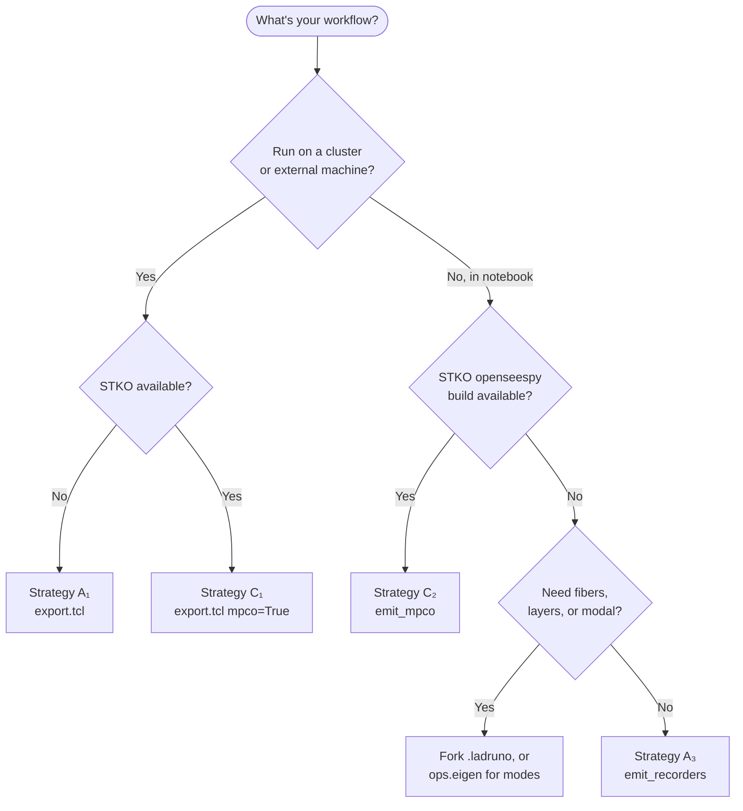

> **Absorbed** into `docs/concepts/results.md` (ADR 0079 P2-C). This guide is retained as working memory; the concepts page is canonical.

# Obtaining Results — Five Ways to Run the Analysis

apeGmsh keeps **what to record** separate from **how to run OpenSees**.
You declare the recorders once, resolve them against your `FEMData`,
and then pick an execution strategy that fits your workflow. All five
strategies produce files that the same `Results` reader can open.

This guide walks through each one with a complete, copy-pasteable
example. They assume the same model setup; only the execution block
differs.

> **Architecture note.** Curious why this works? See
> [Architecture — Obtaining the database](../architecture/apeGmsh_results_obtaining.md)
> for the spec-as-seam pattern and a strategy comparison table.

> **What can I record?** For the full vocabulary — every category,
> every component, every shorthand, with examples — see the
> [Recorder reference](guide_recorders_reference.md). The same
> information is available at runtime via
> `Recorders.categories()`, `Recorders.components_for(category)`,
> and `Recorders.shorthands_for(category)`.

## Tasks on this page

- [Strategy A₁ — Export Tcl, run elsewhere](#strategy-a1-export-tcl-run-elsewhere)
- [Strategy A₂ — Export Python, run elsewhere](#strategy-a2-export-python-run-elsewhere)
- [Strategy A₃ — Live recorders in the notebook](#strategy-a3-live-recorders-in-the-notebook)
- [Strategy B — removed: the in-process capture (#2191)](#strategy-b-removed-the-in-process-capture-2191)
- [Strategy C₁ — Export with MPCO, run with STKO](#strategy-c1-export-with-mpco-run-with-stko)
- [Strategy C₂ — Live MPCO in the notebook](#strategy-c2-live-mpco-in-the-notebook)
- [Picking a strategy](#picking-a-strategy) · [Reading the results](#reading-the-results) · [Common pitfalls](#common-pitfalls)

Related how-to recipes: [Read results back](../how-to/read-results.md) ·
[Record to MPCO](../how-to/results-mpco.md) ·
[Choose a results strategy](../how-to/choose-results-strategy.md).

## Shared setup — declaration and resolution

Every strategy starts here:

```python
from apeGmsh import apeGmsh, Results
from apeGmsh.opensees import apeSees, OpenSeesModel

with apeGmsh(model_name="demo") as g:
    # ... build geometry, mesh, physical groups ...
    fem = g.mesh.queries.get_fem_data(dim=3)

# OpenSees — post-session, explicit declarations.
ops_bridge = apeSees(fem)
ops_bridge.model(ndm=3, ndf=3)
# ... materials, elements, fix, patterns (re-declare explicitly) ...

# Persist the canonical two-zone model.h5 once, then rehydrate the
# read-side broker. Every Results constructor below requires it
# (model=/model_h5=); omitting it raises TypeError (ADR 0020 INV-1).
ops_bridge.h5("model.h5")
model = OpenSeesModel.from_h5("model.h5")

# Declare what you want recorded on the apeSees bridge
ops_bridge.recorder.Node(
    nodes=fem.nodes.get_ids(pg="Top"), dofs=[1, 2, 3], response="disp")
ops_bridge.recorder.Element(
    elements=fem.elements.get_ids(pg="Body"), response="stress")

# Build the frozen, gmsh-independent spec directly
from apeGmsh.results.spec import ResolvedRecorderSpec, ResolvedRecorderRecord

spec = ResolvedRecorderSpec(
    fem_snapshot_id=fem.snapshot_id,
    records=(ResolvedRecorderRecord(
        category="nodes", name="top",
        components=("displacement_x", "displacement_y", "displacement_z"),
        dt=None, n_steps=None,
        node_ids=fem.nodes.get_ids(pg="Top"),
    ),),
)

    # ... pick a strategy below ...
```

`spec` is a frozen `ResolvedRecorderSpec`. From here, you have **five
ways** to run the analysis and read results.

---

## Strategy A₁ — Export Tcl, run elsewhere

For cluster jobs, reproducible scripts, or non-Python tooling.

```python
ops_bridge.tcl("model.tcl", recorders=spec)
# … you run OpenSees on the cluster, files land in out/ …
```

Then from your laptop, parse the recorder output:

```python
results = Results.from_recorders(spec, "out/", fem=fem, model=model)
disp = results.nodes.get(component="displacement_z", pg="Top")
```

| Pros | Cons |
|---|---|
| Reproducible script you can check in | Requires running OpenSees externally |
| Cluster-friendly | Two-process workflow |
| Output cached by file mtime + spec hash | |

---

## Strategy A₂ — Export Python, run elsewhere

Same as A₁ but `ops.recorder(...)` source instead of Tcl.

```python
ops_bridge.py("model.py", recorders=spec)
# … run python model.py, files land in out/ …

results = Results.from_recorders(spec, "out/", fem=fem, model=model)
```

Use when the rest of your production pipeline is Python.

---

## Strategy A₃ — Live recorders in the notebook

The new in-process classic-recorder path. Same recorder commands as
A₁/A₂, but pushed directly into the live `openseespy` domain — **no
script written, no subprocess**.

```python
import openseespy.opensees as ops

# model: the OpenSeesModel built from the same FEMData, required for node
# and element records: it maps element FEM ids to the OpenSees tags they
# were built with, and each node's DOFs to its own layout (a 2-D frame's
# rotation_z is DOF 3), #2018
with spec.emit_recorders("out/", model=model) as live:
    # First stage
    live.begin_stage("gravity", kind="static")
    ops.system("BandSPD"); ops.numberer("RCM"); ops.constraints("Plain")
    ops.test("NormDispIncr", 1e-6, 20); ops.algorithm("Newton")
    ops.integrator("LoadControl", 0.1); ops.analysis("Static")
    for _ in range(10):
        ops.analyze(1)
    live.end_stage()

    # Second stage — different integrator / pattern, same recorders
    live.begin_stage("dynamic", kind="transient")
    # ... set up dynamic analysis ...
    for _ in range(n_steps):
        ops.analyze(1, dt)
    live.end_stage()

# Read each stage independently
grav = Results.from_recorders(spec, "out/", fem=fem, model=model, stage_id="gravity")
dyn  = Results.from_recorders(spec, "out/", fem=fem, model=model, stage_id="dynamic")
```

When `stage_id` is set and `stage_name` is left at its default (`"analysis"`), `from_recorders` mirrors `stage_name = stage_id` automatically so the loaded Results stage carries the meaningful name (`Results.py:179-180`).

### How it works

- `__enter__` validates the spec; raises immediately if it contains
  any **modal** records (modes come from `ops.eigen(n)`, or
  `capture_live_modes` for a plain openseespy deck).
- `begin_stage(name, kind)` issues `ops.recorder("Node", ...)` /
  `ops.recorder("Element", ...)` calls with output filenames prefixed
  `<name>__` so per-stage files don't collide.
- `end_stage()` removes the recorders, which is what flushes their
  output files.
- `__exit__` auto-closes any forgotten stage and warns if you exited
  without ever calling `begin_stage`.

### Coverage

| Category | Status |
|---|---|
| `nodes` | Supported |
| `elements` (per-element-node forces) | Supported |
| `gauss` (continuum stress/strain) | Supported |
| `line_stations` (beam section forces) | Supported (emits paired integrationPoints recorder) |
| `fibers` | Warn-and-skip — use `spec.emit_mpco` or the fork's `.ladruno` |
| `layers` | Warn-and-skip — same |
| `modal` | **Raises** at `__enter__` — use `ops.eigen(n)` / `capture_live_modes` |

| Pros | Cons |
|---|---|
| Notebook-native, no subprocess | Read one stage at a time |
| Multi-stage with proper scoping | Modal not supported |
| Same recorder semantics as Tcl | |

---

## Strategy B — removed: the in-process capture (#2191)

apeGmsh used to query the live `ops` domain itself and write its own
native HDF5 (`DomainCaptureSpec` / `ops.domain_capture`). That route was
deleted in #2191; files it wrote stay readable with
`Results.from_native` (their `source_type` is `"domain_capture"`). Its
jobs moved:

| Job | Route now |
|---|---|
| Record an in-process run | `spec.emit_default("run", model_h5=...)` — the fork's `.ladruno`, MPCO on a stock build that has it, classic `.out` on pip; read with `run.results()` |
| Several stages in one notebook run | Strategy A₃ (`emit_recorders`, one `begin_stage` per stage) |
| Modes of a bridge model | `ops.eigen(n)` → `EigenResult.to_native(path)` / `.results()` |
| Modes of a plain openseespy deck | `apeGmsh.results.live.capture_live_modes(model_h5, n, path)` |
| Fibres, layers, per-material Gauss | `emit_mpco`, the fork's `.ladruno`, and pip `.out` fibres |

Modes now land in their own native file: no route writes a run's
static, mode and transient stages into one file the way the capture
did (the open question is on #2191).

---

## Strategy C₁ — Export with MPCO, run with STKO

For the STKO ecosystem and big parallel runs. For a focused recipe see
[Record to MPCO](../how-to/results-mpco.md).

```python
ops_bridge.tcl("model.tcl", recorders=spec, mpco=True)
# … run with STKO loaded — produces run.mpco …

results = Results.from_mpco("run.mpco", model_h5="model.h5")
```

apeGmsh emits a single `recorder mpco …` line into the script; STKO
writes the HDF5 file. apeGmsh's `MPCOReader` reads it directly without
re-transcoding. `from_mpco` takes the broker as a **path**
(`model_h5=`, the canonical `model.h5`), not the in-memory `model`
object; omitting it raises TypeError.

For parallel runs:

```python
# Multi-partition .mpco — auto-discovers .part-N siblings
results = Results.from_mpco("run.part-0.mpco", model_h5="model.h5")

# Opt out of auto-discovery (read only the named partition)
results = Results.from_mpco(
    "run.part-0.mpco", model_h5="model.h5", merge_partitions=False)
```

| Pros | Cons |
|---|---|
| Battle-tested STKO recorder | Requires STKO-loaded OpenSees |
| Fast, parallel-aware | External run |
| Native MPCO support for fibers / layers / modal | |

---

## Strategy C₂ — Live MPCO in the notebook

The MPCO recorder in-process. Requires an `openseespy` build with
MPCO compiled in (typically STKO's bundled Python).

```python
import openseespy.opensees as ops

with spec.emit_mpco("run.mpco"):
    # Drive the entire analysis — MPCO writes one file with all stages
    ops.analysis("Transient")
    for _ in range(n_steps):
        ops.analyze(1, dt)

results = Results.from_mpco("run.mpco", model_h5="model.h5")
```

### How it works

- `__enter__` issues a single `ops.recorder("mpco", path, -N <tokens>,
  -E <tokens>)` call for the entire spec.
- **No `begin_stage` / `end_stage` ceremony** — MPCO writes one file
  containing all stages with `pseudoTime` encoding stage boundaries
  internally.
- `__exit__` removes the recorder, which flushes the HDF5 file.

### Build-gate

If the active openseespy build doesn't include the MPCO recorder,
`__enter__` raises with a clear remediation pointer:

```text
RuntimeError: ops.recorder('mpco', ...) failed. The most likely cause
is that the active openseespy build does not include the MPCO
recorder; vanilla openseespy distributions do not ship it.
Workable options:
  - run inside STKO's bundled Python distribution
  - use spec.emit_recorders(...) for classic recorders + Results.from_recorders(...)
  - export with ops.tcl(..., recorders=spec, mpco=True) and run with STKO loaded
```

### Coverage

| Category | Status |
|---|---|
| `nodes`, `elements`, `gauss`, `line_stations` | Supported |
| `fibers` (`section.fiber.stress`) | **Native** |
| `layers` (layered-section tokens) | **Native** |
| `modal` (`modesOfVibration`) | **Native** |

| Pros | Cons |
|---|---|
| Notebook-native, no subprocess | **Requires STKO-loaded openseespy** |
| Full coverage including fibers / layers | |
| MPCO output is parallel-aware | |

---

## Picking a strategy

See also the decision-focused [Choose a results strategy](../how-to/choose-results-strategy.md) recipe.



**Quick rules of thumb:**

- **Notebook + you control the build:** Strategy C₂ if you have STKO,
  `emit_default` otherwise.
- **Notebook + simple recorders only:** Strategy A₃.
- **Notebook + need modal / fibers / layers + no STKO:** modes from
  `ops.eigen(n)`; fibres and layers from the fork's `.ladruno`.
- **Cluster:** Strategy A₁ for general OpenSees, Strategy C₁ for STKO
  shops.
- **Mixing in Python tooling:** Strategy A₂ (same as A₁ but Python
  source).

---

## Reading the results

All five strategies feed into the same `Results` API. After you have
a `results` object, the read code is identical (see also the
[Read results back](../how-to/read-results.md) recipe):

```python
# Auto-resolve when there's only one stage
disp = results.nodes.get(component="displacement_z", pg="Top")

# Multi-stage: pick one
gravity = results.stage("gravity")
sigma = gravity.elements.gauss.get(component="stress_xx", pg="Body")

# Modes (kind="mode" stages)
for mode in results.modes:
    print(mode.mode_index, mode.frequency_hz)
    shape = mode.nodes.get(component="displacement_z")

# Visualize — in a notebook use the kernel-safe web viewer.
# results.viewer() defaults to blocking=None (auto): scripts block;
# a Jupyter kernel takes the subprocess / show_web path. Explicit
# blocking=True still CRASHES the kernel.
results.show_web()
```

See [`apeGmsh.results.Results`](../api/results.md) for the full
composite API and slab dataclass shapes.

---

## Common pitfalls

### "I called `emit_recorders` but no files appeared"

You forgot `begin_stage` / `end_stage`. The `LiveRecorders` lifecycle
requires explicit stage markers. Exiting the `with` block without any
`begin_stage` call will warn — check your stderr.

### "`Results.from_recorders` can't find the file"

If you used `emit_recorders` (Strategy A₃), you **must** pass
`stage_id=` matching the name you gave to `begin_stage`:

```python
# Wrong — looks for r_disp.out
Results.from_recorders(spec, "out/", fem=fem, model=model)

# Right — looks for gravity__r_disp.out
Results.from_recorders(spec, "out/", fem=fem, model=model, stage_id="gravity")
```

### "`emit_mpco` raises about the build"

You're running on a `openseespy` build without the MPCO recorder.
Either switch to STKO's bundled Python distribution, or fall back
to Strategy A₃ (`emit_recorders`) or `emit_default`.

### "`emit_recorders` raises about modal records"

The classic recorder path can't drive `ops.eigen()`. Take the modes
from the eigen solve instead, into their own file:

```python
# Modes → ops.eigen on the bridge (capture_live_modes for a plain deck)
ops.eigen(10).to_native("modes.h5")

# Other records → emit_recorders separately
with spec.emit_recorders("out/", model=model) as live:
    live.begin_stage("dynamic")
    ...
```

Or split them at declaration time so the spec for `emit_recorders`
doesn't contain modal records.
