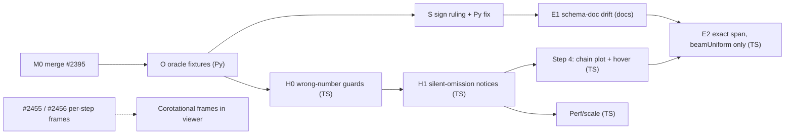

# apeGmshViewer line diagrams: hardening and next steps

> **Status:** Active (2026-10-22). Chain V, program #1283. Slices: O #2471, H0a #2472, H0b #2473, B twin #2474; later slices get cards as their dependencies land.

Baseline: apeGmsh `origin/main` @ `271225b2`. Shipped: Escalones 1–3 (#2140), native `results.h5` stations (#2142).
Inputs: the hardening audit and the exact-span feasibility study (both read-only, done 2026-10-22).

> [!IMPORTANT]
> The audit found **four ways the viewer can show a wrong diagram with no warning**. It also found a **likely `Vz` sign mismatch** between the Python span reconstruction and the measured OpenSees catalog. Hardening and a real OpenSees oracle come before any new feature.

## Principles for every slice

- **A new gate fails before it passes.** Reintroduce the bug, watch the test go red, restore the fix, and say so in the PR.
- **Refuse by name, never silently** (ADR 0112 / 0122). If a beam is not drawn, the notice says how many were skipped and why.
- **Never mix Python and TypeScript in one PR.** Two slices that touch `state/lineDiagram.ts` never run in parallel.
- **The oracle is OpenSees**, not hand-derived comments, and not the Python reconstruction: it has its own sign question.
- **Opus review at the three critical points:** the oracle fixtures (O), the sign ruling (S), and the exact-span port (E2).

## Order of work

---

## M0: land what is ready

- **PR #2395**: CI green, mergeable. It fixes the over-2^24 limit in `readLineStations` (part of #2362). Merge it first, with `land_pr.py`, so the H-slices rebase onto it.

## O: OpenSees oracle fixtures (Python, `tests/` + `apeGmshViewer/fixtures/`)

Every later slice depends on this one. It replaces "oracle" tests whose expected values were derived by hand.

- A generator script runs **stock OpenSees** (with the fork where it is needed) and writes small `model.h5` + `.ladruno` pairs. A golden JSON of expected values at named stations goes beside them.

| Fixture | What it pins |
|---|---|
| SS beam, UDL, elastic | sagging moment drawn on the tension side; `Mz(L/2)=wL²/8` |
| 3-D cantilever, tip loads in y and z | `My` vs `Mz` plane, `Vz` sign, torsion sign |
| force-based beam, **Legendre** and **Lobatto** | station xi read from `GP_PARAM`, never linspace |
| element with i/j reversed relative to the gmsh cell | the orientation guard (P0-2) |
| vertical column, 3-D, explicit `vecxz` | the frame path; a degenerate-`vecxz` variant for P0-4 |
| `basicForce` / `axialForce`-only element | rank-2 sign parity |

- TS tests read the golden JSON. Python tests read the same JSON, so both sides are held to one truth.
- **Probe first** (feeds P0-2): does apeGmsh ever emit an element whose `iNode` is not the cell's first corner? Answer from the emitter, then from a live model.
- **Opus review #1:** are the fixtures and expected values right, independently of either implementation?

## H0: wrong-number guards (TS, `apeGmshViewer/`)

Up to three small PRs. They share `state/lineDiagram.ts`, so they land one after another.

| ID | Defect (audit evidence) | Fix | Gate (fails before the fix) |
|---|---|---|---|
| P0-1 | `gpParamFor` ignores `@PARAM_DOMAIN`; a GAUSS_ID/GP_PARAM mismatch falls back silently to linspace (`reader/ladruno.ts:1230-1320`) | refuse a missing or unknown domain by name; warn on any linspace use; refuse xi outside [-1,1] or non-finite | the Legendre fixture without `PARAM_DOMAIN` throws `LadrunoError` naming it |
| P0-3 | an undecoded element type turns every integer arg into a transform candidate, and the scan matches any transform (`state/lineDiagram.ts:492-547`, from #2142) | no candidates for undecoded types; fall back only when the model has exactly one transform; otherwise skip the beam | unknown type, node tag 2, transforms 1 and 2: the beam is skipped |
| P0-4 | a `vecxz` parallel to the beam is silently swapped for the default in 3-D (`:365-372`) | `beamLocalAxes` returns null; skip the beam unless 2-D or no 3-D frame is needed | vertical 3-D beam with `vecxz=(0,0,1)` and `Mz`: skipped, and counted in the notice |
| P0-2 | the diagram runs along the gmsh cell order, not the element's i→j (`mesh/build.ts:164`, `lineDiagram.ts:874-1039`) | compare against element connectivity; reverse xi when reversed; refuse when unknown | reversed-element fixture: the node-i value is drawn at the correct end |

P0-2's size depends on the O probe. If apeGmsh never reverses, it shrinks to a guard and its test.

Python twin (a separate PR): `_ladruno_element_io.py` per-gid fallback (`:2271-2276`) warns, matching P0-1.

## H1: silent omissions become notices (TS)

One PR, or two if it grows:

- **Zero beams drawn:** say why ("no line-station row joins a drawn beam", "N of M rows unjoined"). Covers `renderer/lineDiagram.ts:183-189, 294-299` and `effects.ts:446`.
- **Count every skip reason** (non-finite values, zero length, no join, frame) in one notice (`state/lineDiagram.ts:855-888`).
- **Warn on unreadable buckets:** every token in `availableLineStations`; `readLineStations` names the bucket it skipped (`reader/ladruno.ts:484-612`).
- **Isolate line-diagram refusals:** a refused line read stops failing the nodal contour and deform for that step (`main/results.ts:480-489`). It returns `lineDiagram: {error}` instead.
- **Deformed-baseline mismatch:** when the displacement doesn't fit, hide the layer with a notice, rather than drawing it undeformed under a deformed mesh (`renderer/lineDiagram.ts:203-225`).
- **Reference frame on a deformed baseline:** a notice when deform is on and the frame is not per-step. This is an honest stopgap until #2455/#2456.
- **Component auto-switch:** emit the notice the comment promises (`reduce.ts:234-245, 501-520`). Record why `preferSlabMy` exists, or remove it.
- Each item gets an effects or reducer test asserting a non-null, specific notice.

**#2024** (Python Qt `_kind_catalog.py`, the same swallow pattern): goes to T for the Qt-sunset ruling. It is not part of this program unless T says so.

## S: the sign ruling (Python, with a convention ADR if needed)

- **`Vz` in `_beam_diagrams.py`:** its convention (`Vz(0)=+Vz_I`) conflicts with the measured catalog (`_response_catalog.py:2120-2134`, shear_z end-i = −1), which the viewer follows. Settle it against the O cantilever fixture. Fix `_beam_diagrams.py` and its pinned test (`test_beam_span_diagrams.py:643`) in a Python-only PR.
- **Curvature side vs moment side:** `kappaZ/kappaY` default to `flipSign=false` while `Mz/My` use the tension side, so an elastic section shows them on opposite sides. Python has the same defaults. Rule on it once (an ADR amendment if it is a convention), then apply it in both codebases with separate PRs.
- **Opus review #2** on the ruling before E2 starts.

## Step 4: 2-D chain plot and hover readout (TS)

This wires up code that is built and tested but has no caller.

- **Hover needle:** `projectHoverNeedle` shows the value, x/L and element id at the cursor on a beam.
- **2-D chain plot:** `buildSelectedBeamChainsFromState` → an SVG plot of selected beams laid out end to end, with joint markers and node ids, plus per-span extrema.
- **Fixes that come with the wiring:**
  - Nothing selected: show a prompt. Today it falls back to **every** beam (`lineDiagram.ts:1541`), unusable on a real model.
  - Gauss stations (no end points): draw the beam ends as **marked, unknown**, not the flat clamp `interpolateStationValue` gives today (`:1159-1160`). Exact ends come in E2.
  - Non-contiguous selection: one plot per chain, labelled.
- Gates:
  - Reducer and selector tests for selection to chains.
  - A DOM test of the panel.
  - The hover value at a station equals the golden station value.

## E: exact span diagrams (TS, after S)

- **E1, docs only.** Fix `h5-schema.md` drift:
  - `element_loads` is a 2-D string table of raw `eleLoad` tokens (`_h5_write_model.py:1213-1235`), not the documented compound.
  - The time series has no `time/values` sampling on disk.
  - ADR 0112 D4 allows the viewer to rely only on what the schema documents, so this must land first.
- **E2, TS port (Opus review #3).**
  - A pure `state/spanLoads.ts`. It parses `-beamUniform` in its 2/3/5/8 (3-D) and 2/4/6 (2-D) forms, then maps ops tag to FEM id through `joinLadrunoElements`.
  - It ports the statics of `_beam_diagrams.py:184-355` with the **ruled** signs, adding zero-shear roots and load breakpoints as stations.
  - **Only enabled when all of these hold:**
    - every load on the element is `-beamUniform`;
    - λ is computable from the series (Constant, Linear, inline Path, Trig) at the recorded TIME;
    - load control, single active pattern set;
    - small-displacement transform (not corotational).
  - **Closure check per element:** reconstructed `N, V, M, T` at x=L must match the recorded node-j end forces within tolerance. Otherwise fall back to the station drawing, with the reason. This catches `-beamPoint`, self-weight, membranes and λ errors.
  - The panel shows which beams are exact and which are interpolated.
  - Gates: the O fixtures at L/2; a beam carrying a point load must fail closure and fall back with a notice.
- **E3, later (needs an ADR: a schema change in apeGmsh, maybe the fork).** A typed element-load table, recorded per-step pattern λ / `loadConst` state, and persisted membrane `subSegmentLoads`. Not scheduled until E2 has run on real models.

## Perf and scale (TS, after H1)

| Item | Fix |
|---|---|
| History scan reads the whole `nSteps × nStations` slab (`main/results.ts:608`); ~800 MB at 10k beams × 2000 steps | hyperslab per chunk |
| Geometry built twice per change, with different charLength/baseline (`effects.ts:430` vs `renderer/lineDiagram.ts:275`) | one build; range from it |
| Screen-plane rebuilds on every camera move (`:360-364`) | throttle, or shader extrusion |
| Cache key misses the element mask, stage activation and isolate (`:242-256`, `effects.ts:411`) | add them; a test where the mask changes and the diagram must rebuild |
| Allocation-heavy build (`number[]`, per-vertex colour objects) | typed arrays; benchmark on a 10k-beam fixture |

Scale ceiling: depends on #2362's supported-scale decision. Use 10k beams as the working target until then.

## Corotational beams (blocked, cross-repo)

- The viewer can't draw per-step frames until the fork writes them (#2456) and the reader lands (PR #2455, #2451).
- Until then, the H1 notice says so.
- When it unblocks: read the `[T × nE × 4]` quaternion bucket and use it as the step frame. E2 stays disabled for these beams.

## Work packages at a glance

| Slice | Lang | Depends on | Size | Review |
|---|---|---|---|---|
| M0 merge #2395 | — | — | XS | CI |
| O oracle fixtures + orientation probe | Py | M0 | M | **Opus #1** |
| H0 P0-1/3/4 (+P0-2) | TS | O | S–M ×3 | Opus on P0-2 only if it grows |
| H0-py gid-fallback warning | Py | — | XS | — |
| H1 notices | TS | H0 | M | — |
| S sign ruling + Py fix | Py/ADR | O | S | **Opus #2** |
| Step 4 chain plot + hover | TS | H1 | M | — |
| E1 schema-doc drift | docs | S | XS | — |
| E2 exact span (beamUniform) | TS | E1, Step 4 | L | **Opus #3** |
| Perf/scale | TS | H1 | M | — |
| E3 typed loads / λ / membranes | ADR + Py (+fork) | E2 in use | L | ADR |

Tracking: one `[V]` issue per slice under program #1283, with this plan as `internal_docs/plan_viewer_line_diagrams.md`.

## Open decisions for you

1. **E2 scope:** is "exact only when every load is `-beamUniform`, otherwise interpolated with a badge" acceptable for the first release?
2. **Curvature drawing side:** match the moment (tension side), or keep today's defaults?
3. **Perf target:** 10k beams × 2000 steps is a working number. Is there a real model to benchmark on (e.g. YOO Guayaquil)?
